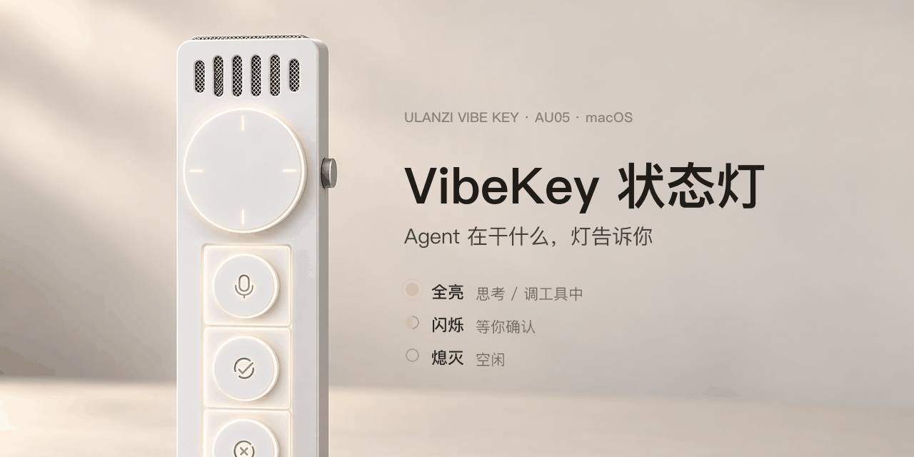

# VibeKey Status Light · Agent Status Light for Ulanzi AU05

Turn the lights on your Ulanzi Vibe Key (AU05) microphone — plus a macOS menu bar item —
into a status indicator for a local AI agent.


English · [中文](./README.md)

---

## Why

When an agent runs long tasks on your machine, it spends most of its time in the
background. To know whether it is thinking, waiting for your confirmation, or has
stopped on an error, you keep switching windows — dozens of times a day.

There is already a light on your desk. Let it talk:

- **Glance up after finishing an edit** — know whether to keep waiting
- **Switch to other work** — a blink means it needs a decision from you
- **No dashboard, no second window** — status at the edge of your vision

The lights are driven over raw HID, not through Ulanzi Studio's status sync
(Studio does not map AU05 states today — see [`docs/设备笔记.md`](docs/设备笔记.md)).

When the light is out of reach — or you simply do not want it lit — the same state
lives in the **macOS menu bar**: one coloured dot plus a short label.

## Five states (light and menu bar share one source)

```text
Agent state             Light                                  Menu bar
──────────────────    ───────────────────────────────────    ──────────────────────────
Thinking              full on (brightness 20)                 ● 思考 (blue)
Calling tools         full on                                 ● 工作 (orange)
Waiting for answer    1 ↔ 20: 6 blinks → 2.5s pause → repeat   ● 确认 (purple, blinks)
Tool error             ~2s fast blink → steady                 ● 报错 (red, blinks)
Turn finished         keys off, faint dial glow               ● 收尾 (teal)
Idle                  keys off, faint dial glow               ● 空闲 (gray)
```

The menu bar also has `○ 暂停` (lighting muted by hand) and `○ 离线`
(the bridge stopped writing its heartbeat — time to reload).

## Features

**State awareness**

- Tails Proma's live session event stream (`~/.proma/sdk-config/sessions/*.jsonl`)
- Distinguishes thinking / tool-calling / awaiting-confirmation / error / idle
- Correct end-of-turn detection: the last record must be an assistant message
  *without* a tool call, plus 1.6s of silence — long-running commands emit no events

**Light control**

- Raw HID control — no Ulanzi Studio dependency, dial and buttons keep working
- Full-on / work mode / per-step brightness / looping pulse / breathe / per-LED
- Re-asserts brightness every 45s while busy, to survive the device's 5-minute idle standby

**Menu bar status**

- Native `NSStatusItem`, one Swift file compiled into `VibeKeyStatusBar.app`, no third-party deps
- Coloured dot + short label (`● 思考` / `● 工作` / `● 确认` …), blinking for confirm and error
- Menu shows the full state, last update time, pause toggle, icon-only mode, reload, open logs
- Bridge writes a heartbeat every 5s; older than 20s shows `○ 离线` — a free health check
- Tooltip carries the full state, active session count and update time

**Engineering**

- Two LaunchAgents: `com.proma.vibekey-bridge` (light) and `com.proma.vibekey-menubar` (status bar);
  both start at login, restart on crash, `install.sh` is idempotent
- Logs and pause flag under `~/Library/Logs/PromaVibeKey/` (`touch pause` to mute)
- Optionally reports state as a hook event to Ulanzi Studio (`--no-studio` to disable)
- The event source is plain JSONL — adapting another agent only needs a small parser

## Quick start

**Requirements**: macOS 13+, Python 3, a Ulanzi Vibe Key (AU05) with its receiver.

```bash
git clone https://github.com/yinsitong/vibekey-agent-light.git
cd vibekey-agent-light

./install.sh                 # registers both LaunchAgents (light + menu bar)
python3 bridge.py --status   # show the currently detected state
```

If the menu bar app is missing, `install.sh` calls `./build-menubar.sh` automatically
(needs Xcode Command Line Tools). Or build it up front: `./build-menubar.sh`.

`install.sh` writes this directory's absolute path into the LaunchAgent.
**Re-run it after moving the folder.**

Uninstall:

```bash
./uninstall.sh
```

Test the light without an agent:

```bash
python3 bridge.py --send confirm   # should blink
python3 bridge.py --send idle      # should dim
```

Test only the menu bar (no light, no Studio):

```bash
python3 bridge.py --publish thinking   # menu bar should switch to «● 思考»
```

## Tuning

All knobs live at the top of `bridge.py`:

| Variable | Default | Meaning |
| --- | --- | --- |
| `BUSY_STATES` | `{"thinking", "working", "error"}` | states treated as "busy" |
| `BRIGHT_LEVEL` | `20` | full brightness, **hard cap 20** (21 reads back as 21 but renders as off) |
| `IDLE_MODE` | `2` | idle light mode; `0` = all off, highest contrast |
| `PULSE_MS` | `250` | milliseconds per blink half-cycle |
| `PULSE_LOW` / `PULSE_HIGH` | `1` / `20` | dim / bright levels |
| `PULSE_BURST` | `6` | blinks per burst |
| `PULSE_GAP` | `2500` | pause between bursts (ms) |
| `PULSE_STATES` | `{"confirm", "error"}` | which states blink; `set()` keeps only on/off |

Reload after editing:

```bash
./install.sh
# or
launchctl kickstart -k gui/$(id -u)/com.proma.vibekey-bridge
```

Temporary mute:

```bash
touch ~/Library/Logs/PromaVibeKey/pause    # pause
rm ~/Library/Logs/PromaVibeKey/pause       # resume
```

## How it works

```text
┌──────────────────────┐        ┌──────────────┐        ┌─────────────────┐
│ Proma main process   │        │  bridge.py   │        │  Ulanzi AU05    │
│ sessions/*.jsonl     │──tail─▶│ state machine│──HID──▶│ dial + 3 keys   │
│ (live, per-event)    │        │ debounce     │        │                 │
└──────────────────────┘        └──────┬───────┘        └─────────────────┘
                                       │ status.json (5s heartbeat)
                                       ▼
                                ┌──────────────┐
                                │ menu bar app │──▶ «● 工作» in the menu bar
                                └──────────────┘
```

`bridge.py` tails the event files, translates each event into an internal state,
and calls `bin/vibekit-led` (a Swift HID tool) whenever the state changes.

## Manual control & debugging

```bash
BIN="./bin/vibekit-led"

$BIN busy 20                 # full on at brightness 20
$BIN mode 2                  # work mode (dim)
$BIN pulse 6 250 1 20        # blink 6 times
$BIN dump88                  # read back all lighting bytes
$BIN status                  # device summary
```

All subcommands: `busy` `pulse` `pulse-loop` `mode` `dial` `dialcfg` `flash`
`dump88` `ledtypes` `breathe` `ledrestore` `status` `get` `dump` `probe` `sniff`.

```bash
tail -20 ~/Library/Logs/PromaVibeKey/bridge.log
```

## Three gotchas worth knowing

1. **Brightness tops out at 20.** Writing 21 does not error and reads back as 21,
   but the device treats it as *off*.
2. **The device only re-applies brightness when the value changes.** Writing the
   same value again has no physical effect, and switching modes does not help.
   Hence `busy` writes 19 then 20, and blinking alternates two levels.
3. **The device enters standby after 5 minutes idle.** Writes still return success
   but nothing happens. The bridge re-asserts brightness every 45s while busy.

## Layout

| Path | Purpose |
| --- | --- |
| `bridge.py` | main loop: tail events → state machine → drive lights, writes `status.json` |
| `bin/vibekit-led` | prebuilt HID tool (release build, stripped; `./build.sh` to rebuild) |
| `menubar/VibeKeyStatusBar.swift` | menu bar app source (single file, `NSStatusItem`, 0.5s poll) |
| `bin/VibeKeyStatusBar.app` | compiled menu bar app (`LSUIElement`, no Dock icon) |
| `vendor/` | VibeKit Swift sources from OpenVibeKey (MIT, see [`THIRD-PARTY.md`](THIRD-PARTY.md)) |
| `install.sh` / `uninstall.sh` | register / remove both LaunchAgents |
| `build.sh` | rebuild `bin/vibekit-led` (release + strip, so no local paths are embedded) |
| `build-menubar.sh` | rebuild the menu bar app |
| `docs/设备笔记.md` | HID protocol, lighting bytes, vendor-channel notes |

## Limitations

- macOS 13+ only (HID and LaunchAgent are macOS mechanisms)
- The menu bar item lives on the active display's menu bar; on a very crowded bar (portrait screen, many icons) macOS may fold it into the `«` group — ⌘-drag it, or enable «icon only» in its menu
- Requires the receiver plugged in and the VibeKey powered on; writes are lost during standby (the menu bar keeps showing state)
- The event source is Proma's session format; other agents need an adapter
- `bin/vibekit-led` is a prebuilt arm64 binary — rebuild on Intel with `./build.sh`
- Rebuild via `./build.sh`, not bare `swift build`: it uses release + strip so the build machine's absolute paths stay out of the binary (debug builds embed them and double the size)
- Does not interfere with the VibeKey's own features, but brightness must be re-applied after a device restart

## Credits

- Device reverse engineering & HID protocol: [palaemonboy/OpenVibeKey](https://github.com/palaemonboy/OpenVibeKey) (MIT)
- Event source format: Proma Agent

## License

[MIT](LICENSE) © 2026 Stone Yin
