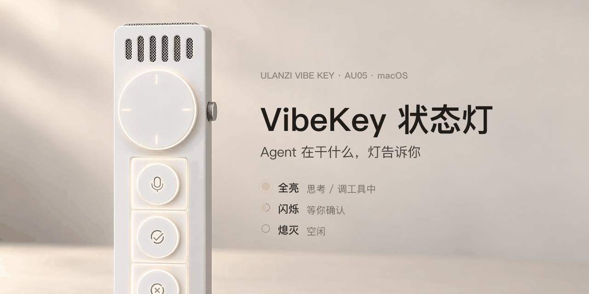

# VibeKey 状态灯 · Agent Status Light for Ulanzi AU05

用 Ulanzi Vibe Key（AU05）麦克风的灯，显示本地 AI Agent 正在干什么。


[English](./README.en.md) · 中文

---

## 它解决什么问题

Agent 在我们本机跑长任务时，大部分时间待在后台。要知道它是在思考、在等你确认，
还是已经报错停下，得反复切窗口看——这个动作一天要重复几十次。

桌面上本来就有一盏灯，让它说话就行：

- **改完文件抬头看一眼** 就知道该不该继续等
- **切出去干别的事**，灯一闪就是它在问你问题
- **不用装仪表盘、不用开第二个窗口**，全是余光可见

灯走设备层 HID 直控，不依赖 Ulanzi Studio 的状态同步
（Studio 目前对 AU05 不做状态映射，调研过程见 [`docs/设备笔记.md`](docs/设备笔记.md)）。

## 四种状态

```text
Agent 状态                  灯的表现
──────────────────────     ────────────────────────────────────────
思考 / 调工具中             旋钮环 + 三颗按键灯全亮（亮度 20，最亮档）
弹问题等你确认              亮度 1 ↔ 20 交替：闪 6 下 → 停 2.5 秒 → 循环
工具报错 / 中断             快闪约 2 秒 → 恢复常亮
本轮结束 / 空闲             按键灯灭，只剩旋钮一圈微光
```

- **全亮**代表"我在干活，别催"
- **闪烁**是全项目最重要的一个信号：它在等你做决定，而且只有你能解
- **微光**是安全状态，说明可以放心离开

## 能力

**状态感知**

- 实时读取 Proma 的会话事件流（`~/.proma/sdk-config/sessions/*.jsonl`，主进程逐条写入）
- 区分「思考 / 调工具 / 等你确认 / 报错 / 空闲」五种内部状态
- 正确判定「本轮结束」：只有最后一条是不含 toolCall 的 assistant 消息、且静默 1.6 秒才算结束——
  长命令执行期间没有事件，不能按静默判空

**灯光控制**

- 设备层 HID 直控，不依赖 Ulanzi Studio、不占用旋钮与按键的正常功能
- 全亮 / 工作模式 / 逐档亮度 / 循环闪烁 / 呼吸 / 单灯控制
- 忙态每 45 秒补写一次，抵抗设备 5 分钟无操作自动待机

**工程细节**

- LaunchAgent 托管：登录自启、崩溃拉起、可反复执行 `install.sh`
- 状态文件与日志落在 `~/Library/Logs/PromaVibeKey/`，`touch pause` 即可临时静音
- 可选把状态作为 hook 事件上报给 Ulanzi Studio（`--no-studio` 可关）
- 事件源格式是公开的 JSONL：接别的 Agent 只需写一个适配器

## 快速开始

**要求**：macOS 13+、Python 3、一台 Ulanzi Vibe Key（AU05）及接收器。

```bash
git clone https://github.com/yinsitong/vibekey-agent-light.git
cd vibekey-agent-light

./install.sh                 # 装 LaunchAgent：登录自启 + 崩溃拉起
python3 bridge.py --status   # 看当前识别到的状态
```

`install.sh` 会把当前目录的绝对路径写进 LaunchAgent。**移动过目录后重跑一次即可。**

卸载：

```bash
./uninstall.sh
```

验证灯是否正常，不依赖 Agent：

```bash
python3 bridge.py --send confirm   # 应该看到一阵抖动
python3 bridge.py --send idle      # 暗下去
```

## 状态映射可以改

`bridge.py` 顶部集中了所有可调参数：

| 参数 | 默认 | 说明 |
| --- | --- | --- |
| `BUSY_STATES` | `{"thinking", "working", "error"}` | 哪些状态算「忙」 |
| `BRIGHT_LEVEL` | `20` | 全亮亮度，**上限是 20**（写 21 设备会当成灭） |
| `IDLE_MODE` | `2` | 空闲时的灯效模式，改 `0` 是全灭，对比最强 |
| `PULSE_MS` | `250` | 闪烁每档毫秒 |
| `PULSE_LOW` / `PULSE_HIGH` | `1` / `20` | 暗 / 亮两档 |
| `PULSE_BURST` | `6` | 每组闪几下 |
| `PULSE_GAP` | `2500` | 组间停顿毫秒 |
| `PULSE_STATES` | `{"confirm", "error"}` | 哪些状态闪；改成 `set()` 就只剩亮/暗 |

改完重载：

```bash
./install.sh
# 或
launchctl kickstart -k gui/$(id -u)/com.proma.vibekey-bridge
```

临时静音（不卸载）：

```bash
touch ~/Library/Logs/PromaVibeKey/pause    # 暂停
rm ~/Library/Logs/PromaVibeKey/pause       # 恢复
```

## 工作原理

```text
┌──────────────────────┐        ┌──────────────┐        ┌─────────────────┐
│ Proma 主进程          │        │  bridge.py   │        │  Ulanzi AU05    │
│ sessions/*.jsonl     │──tail──▶│ 状态机        │──HID──▶│ 旋钮环 + 三键灯  │
│ （逐条实时写入）       │        │ 防抖 + 补写   │        │                 │
└──────────────────────┘        └──────────────┘        └─────────────────┘
                                       │
                                LaunchAgent 托管
```

`bridge.py` 持续 tail 事件文件，把每条事件翻译成内部状态；
状态变化时调用 `bin/vibekit-led`（Swift 编译的 HID 工具）改灯。

## 手动控灯与排查

```bash
BIN="./bin/vibekit-led"

$BIN busy 20                 # 全亮 + 亮度 20
$BIN mode 2                  # 工作模式（暗）
$BIN pulse 6 250 1 20        # 闪 6 下
$BIN dump88                  # 读回全部灯效字节
$BIN status                  # 设备状态概览
```

全部子命令：`busy` `pulse` `pulse-loop` `mode` `dial` `dialcfg` `flash`
`dump88` `ledtypes` `breathe` `ledrestore` `status` `get` `dump` `probe` `sniff`。

日志：

```bash
tail -20 ~/Library/Logs/PromaVibeKey/bridge.log
```

## 三个必须知道的坑

1. **亮度上限是 20。** 写 21 不报错、读回也是 21，但灯会当成「灭」。
2. **设备只在亮度值变化时才重新施加亮度。** 重复写同一个值物理无效，切模式也不管用。
   所以忙态走 `busy`（内部先写 19 再写 20），闪烁靠交替写两个值。
3. **设备 5 分钟无操作进待机。** 待机时写入照常返回成功但灯不动，
   桥在忙态每 45 秒补写一次兜底。

## 目录

| 路径 | 说明 |
| --- | --- |
| `bridge.py` | 主程序：tail 事件流 → 状态机 → 调 `bin/vibekit-led` |
| `bin/vibekit-led` | 设备层 HID 工具（预编译的 release 产物，已 strip；`./build.sh` 可重编） |
| `vendor/` | VibeKit Swift 源码（来自 OpenVibeKey，MIT，见 [`THIRD-PARTY.md`](THIRD-PARTY.md)） |
| `install.sh` / `uninstall.sh` | 注册 / 移除 LaunchAgent |
| `build.sh` | 重新编译 `bin/vibekit-led`（release + strip，避免把本机路径写进二进制） |
| `docs/设备笔记.md` | HID 协议、灯效字节、官方通道调研结论 |

## 已知限制

- 只支持 macOS 13+（HID 与 LaunchAgent 都是 macOS 机制）
- 需要设备接收器插在 Mac 上、VibeKey 开机；设备待机时写入无效
- 事件源目前是 Proma 的会话格式；接其他 Agent 需要写适配器
- `bin/vibekit-led` 是预编译的 arm64 产物。Intel Mac 请用 `./build.sh` 重编
- 重编请走 `./build.sh`，不要直接 `swift build`：它会用 release + strip，避免把构建机的绝对路径写进二进制（debug 产物会，且体积翻倍）
- 不影响 VibeKey 原功能（旋钮、按键、麦克风），但重启设备后需要桥重新施加一次亮度

## Credits

- 设备逆向与 HID 协议：[palaemonboy/OpenVibeKey](https://github.com/palaemonboy/OpenVibeKey)（MIT）
- 事件源格式：Proma Agent

## License

[MIT](LICENSE) © 2026 Stone Yin
